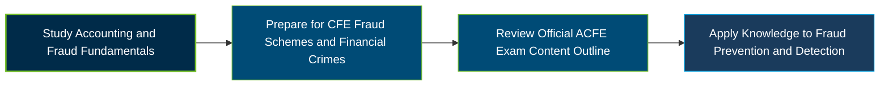

# ACFE CFE Fraud Schemes and Financial Crimes Exam Guide

 

A dedicated study guide for candidates preparing for the **Certified Fraud Examiner (CFE) Exam — Fraud Schemes and Financial Crimes** section, covering accounting concepts, occupational fraud schemes, financial crimes, and fraud prevention and detection.

---

## Exam Overview

The Fraud Schemes and Financial Crimes section is one of three sections of the ACFE Certified Fraud Examiner (CFE) Exam. It assesses knowledge of financial transactions, fraud schemes, and methods used to recognize, prevent, and detect fraud.

- **Exam Format**: Closed-book, closed-notes exam section with multiple-choice and True/False questions.
- **Target Audience**: Fraud examiners, auditors, accountants, compliance professionals, investigators, and anti-fraud practitioners.
- **Prerequisites**: ACFE membership and at least 40 qualifying eligibility points are required to take the CFE Exam; consult the official eligibility requirements.

---

## Core Exam Domains & Knowledge Areas

### 1. Accounting Concepts

- Balance sheets, income statements, and statements of cash flows.
- Cash versus accrual accounting and financial reporting frameworks.
- Relationships among assets, liabilities, revenue, expenses, and profit.

### 2. Financial Statement Fraud

- Manipulation of balance sheets, revenue, expenses, and disclosures.
- Common financial statement fraud schemes.
- Horizontal, vertical, and ratio analysis for identifying anomalies.

### 3. Asset Misappropriation: Cash Receipts

- Skimming and cash larceny schemes.
- Prevention measures for cash-receipt fraud.
- Detection methods and controls for missing or misappropriated receipts.

### 4. Asset Misappropriation: Fraudulent Disbursements

- Cash register disbursements, payment tampering, and billing schemes.
- Payroll fraud and expense reimbursement schemes.
- Prevention and detection controls for fraudulent payments.

### 5. Asset Misappropriation: Inventory and Other Assets

- Common inventory theft schemes.
- Controls designed to prevent inventory misappropriation.
- Detection approaches for missing or improperly handled assets.

### 6. Corruption

- Bribery, kickbacks, conflicts of interest, and economic extortion.
- Methods used to make illegal payments.
- Prevention and detection controls for corruption schemes.

### 7. Theft of Data and Intellectual Property

- Theft of data, trade secrets, research, and other intellectual property.
- Differences between corporate espionage and competitive intelligence.
- Insider threats, cyberattacks, social engineering, and related controls.

### 8. Identity Theft

- Common identity theft schemes and methods.
- Phishing, social engineering, and misuse of AI tools.
- Prevention and detection measures for identity-related fraud.

### 9. Financial Institution Fraud

- Loan and mortgage fraud, new-account schemes, and customer-account theft.
- Common fraud patterns affecting financial institutions.
- Controls for preventing and detecting financial institution fraud.

### 10. Money Laundering

- Money laundering stages, schemes, and transaction methods.
- Customer due diligence, beneficial ownership, and suspicious activity reporting.
- Anti-money laundering frameworks, regulations, and risk controls.

### 11. Securities Fraud

- Insider trading, misrepresentations, omissions, and unsuitable recommendations.
- Securities regulation and relevant enforcement agencies.
- Prevention and detection measures for securities fraud schemes.

### 12. Payment Fraud

- Check, electronic funds transfer, mobile payment, and payment card fraud.
- Prepaid card schemes and account takeovers.
- Controls for preventing and detecting payment fraud.

### 13. Insurance Fraud

- Agent and broker fraud, premium fraud, and claim fraud.
- Property, casualty, life, and workers’ compensation fraud schemes.
- Prevention and detection controls for insurance fraud.

### 14. Health Care Fraud

- Fraud involving insurers, patients, and health care service providers.
- Common fraudulent billing and service-related practices.
- Detection approaches for suspicious health care transactions.

### 15. Consumer Fraud and Scams

- Advance-fee schemes, impersonation scams, and romance fraud.
- Cryptocurrency-related scams, Ponzi schemes, and pyramid schemes.
- Prevention and detection methods for consumer fraud.

### 16. Bankruptcy Fraud

- Liquidation, reorganization, and other bankruptcy processes.
- Roles of trustees, courts, receivers, and insolvency professionals.
- Concealed assets, fraudulent conveyances, and planned bankruptcy schemes.

### 17. Tax Fraud

- Differences between tax evasion and tax avoidance.
- Undeclared income, falsified deductions, and consumption tax schemes.
- Stolen taxpayer identities and tax havens or shelters.

### 18. Cyberfraud

- Social engineering, phishing, business email compromise, and deepfakes.
- Malware types and methods used to facilitate fraud.
- Cyberfraud prevention and detection measures.

### 19. Government and Public Sector Fraud

- Fraud schemes involving government programs, grants, and disaster loans.
- Challenges affecting public-sector fraud prevention.
- Limitations and approaches in public-sector fraud detection.

### 20. Procurement Fraud

- Procurement processes and pre-award bid manipulation or collusion.
- Post-award schemes involving change orders, cost mischarging, and nonconforming goods or services.
- Prevention and detection controls throughout the procurement lifecycle.

---

## Certification Path

This diagram represents a suggested study progression, not an official sequence of separate certifications.

---

## Recommended Practice & Study Resources

Use the current ACFE materials as the primary source, then reinforce learning with structured practice and practical review.

- **CertsGate**: Explore supplementary [CFE Fraud Schemes and Financial Crimes study and practice resources](https://certsgate.com/exams/acfe/cfe-fraud-schemes-and-financial-crimes) to reinforce topic knowledge and identify areas for further review.
- **Practical Study Resource**: Practice analyzing financial statements, mapping fraud risks to internal controls, reviewing sample transactions for red flags, and studying anti-money laundering and fraud-prevention frameworks.
